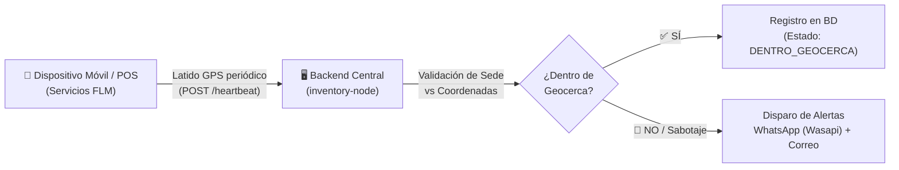

# 📖 Manual de Usuario y Operaciones — Agente de Telemetría Móvil
> **Sistema de Telemetría, Geocercas y Monitoreo de Activos**  
> *Autor: Mauricio Parra | Versión: 1.0.0 | Plataforma: Android 11+ a Android 17*

---

## 📌 1. Introducción y Propósito

El **Agente de Telemetría Móvil** es un servicio de software en segundo plano diseñado para ejecutarse de manera autónoma en terminales POS (**Ciontek CS30**, **Topwise T6D**) y dispositivos móviles corporativos.

Su función es transmitir de forma periódica y silenciosa la ubicación geográfica y el estado de conectividad del dispositivo al sistema central de inventario, permitiendo:
1. **Auditoría de Geocercas**: Validar que cada terminal opere dentro de la agencia o sede autorizada.
2. **Detección Activa de Sabotaje**: Alertar inmediatamente a TI por WhatsApp y correo si alguien intenta revocar permisos de ubicación, apagar el GPS o suplantar coordenadas.
3. **Seguridad y Camuflaje Visual**: La aplicación se presenta bajo la identidad **`Servicios FLM`** para evitar manipulaciones de operarios no autorizados.



---

## 📦 2. Ubicación del Instalador (`.apk`) para Descarga y Compartir

El instalador compilado listo para usar se encuentra en las siguientes ubicaciones:

### En este Computador:
* **Acceso Directo (Raíz del Proyecto)**:  
  📁 [`/home/tecnologia17/desarrollo/inventory-telemetry-agent/ServiciosFLM.apk`](file:///home/tecnologia17/desarrollo/inventory-telemetry-agent/ServiciosFLM.apk) *(18 MB)*
* **Ruta de Compilación Gradle**:  
  📁 [`app/build/outputs/apk/debug/app-debug.apk`](file:///home/tecnologia17/desarrollo/inventory-telemetry-agent/app/build/outputs/apk/debug/app-debug.apk)

### En el Celular de Prueba:
* **Carpeta Descargas**:  
  📁 `/sdcard/Download/ServiciosFLM.apk`  
  *(Puedes abrirlo con el Administrador de Archivos de tu teléfono, o compartirlo directamente por WhatsApp, Telegram, Google Drive o correo a otros técnicos).*

---

## 🔨 3. Cómo Compilar la Aplicación Tú Mismo

Si realizas cambios en el código o deseas generar una nueva versión desde la consola:

### Paso 1: Abrir la terminal en el proyecto
```bash
cd /home/tecnologia17/desarrollo/inventory-telemetry-agent
```

### Paso 2: Ejecutar la compilación
* **Versión de Desarrollo / Pruebas (Debug)**:
  ```bash
  ./gradlew assembleDebug
  ```
* **Versión Optimizada para Producción (Release)**:
  ```bash
  ./gradlew assembleRelease
  ```

### Paso 3: Copiar y desplegar el nuevo APK
Una vez compilado, copia el binario a la raíz y al celular conectado con un solo comando:
```bash
# Copiar a la raíz del proyecto
cp app/build/outputs/apk/debug/app-debug.apk ServiciosFLM.apk

# Instalar directamente en el celular conectado por USB
adb install -r ServiciosFLM.apk

# Guardar una copia en la carpeta Descargas del celular
adb push ServiciosFLM.apk /sdcard/Download/ServiciosFLM.apk
```

---

## ⚙️ 4. Guía de Instalación y Enrolamiento en Terminales

El proceso de enrolamiento se realiza **una sola vez** al entregar el equipo a la taquilla o sede:

### Paso 1: Instalar el APK
* Abre el archivo `ServiciosFLM.apk` en el dispositivo y presiona **Instalar** (o actualiza si ya existía una versión previa).

### Paso 2: Abrir la App Camuflada
* En el menú de aplicaciones del equipo, abre el icono de **`Servicios FLM`**.
* Verás la pantalla corporativa oscura de inicio de sesión con el microbús institucional.

```text
┌───────────────────────────────────────────────┐
│              [ LOGO MICROBÚS ]                │
│               FLOTA LA MACARENA               │
│          Servicios Operativos y Soporte       │
│                                               │
│  👤 [ Usuario                               ] │
│  🔒 [ Contraseña                            ] │
│                                               │
│           ¿Olvidó su contraseña?              │
│                                               │
│               [ ➔ INGRESAR ]                  │
│                                               │
│          v1.0.0 - Flota La Macarena S.A.      │
└───────────────────────────────────────────────┘
```

### Paso 3: Desbloquear el Panel de Enrolamiento (Técnico de TI)
1. En el campo **Usuario**: escribe `admin` (o tu nombre).
2. En el campo **Contraseña**:
   * **Con conexión al servidor**: Escribe la contraseña activa del portal web (ej: `FLM#Admin2029`).
   * **Sin internet / Modo Fuera de Línea**: Escribe la llave maestra de emergencia (`FLM#Admin2026`).
3. Presiona **INGRESAR**.

> [!CAUTION]
> **Bloqueo de Seguridad**: Si se ingresa una contraseña incorrecta 3 veces consecutivas, la app se bloqueará por **5 minutos (300 segundos)** con un contador en pantalla.

### Paso 4: Completar los Parámetros del Dispositivo
En el diálogo de enrolamiento que se abrirá:
1. **Placa del Activo**: Ingresa la placa exacta del inventario (ej: `1528-007885` o `1528-003000`).
2. **URL del Servidor**:
   * Pruebas locales por USB (`adb reverse`): `http://localhost:3000`
   * Red local Wi-Fi: `http://192.168.1.X:3000`
   * Servidor de Producción: `https://inventario.flotalamacarena.com`
3. **API Key de Telemetría**: `flm-telemetry-secret-key-2026`
4. **Intervalo de Latido**: `15` minutos (recomendado) o el deseado.
5. Presiona **"Guardar y Enrolar"**.

### Paso 5: Conceder los Permisos del Sistema Operativo
La aplicación te solicitará dos permisos vitales en Android:
1. **Permiso de Ubicación**:
   * Selecciona **"Mientras la app esté en uso"**, y cuando el sistema abra la configuración de Android, cambia la opción a:  
     👉 **"Permitir todo el tiempo"** (*Allow all the time*).  
     *(Esto permite que el equipo reporte incluso con la pantalla apagada o en el bolsillo).*
2. **Exención de Optimización de Batería**:
   * Presiona **Permitir** en el cuadro de diálogo para evitar que Android congele el proceso al entrar en reposo.

---

## 🔑 5. Gestión y Jerarquía de Contraseñas

| Escenario | Clave a Utilizar | Dónde se Administra | Comportamiento |
| :--- | :--- | :--- | :--- |
| **🌐 En Línea (Con Red / Servidor)** | **`FLM#Admin2029`** *(o la configurada)* | Portal Web (`Catálogos -> Telemetría`) o `.env` | La app consulta al servidor en tiempo real. Si cambias la contraseña en la web, aplica de inmediato para todas las terminales del país. |
| **📴 Fuera de Línea (Sin Internet / Bodega)** | **`FLM#Admin2026`** | Embebida con Hash SHA-256 + Salt seguro | Funciona de manera autónoma en hardware sin requerir red. Garantiza que el técnico de TI jamás quede bloqueado. |

---

## 🛡️ 6. Protocolo Ante Intentos de Sabotaje

Si un usuario en taquilla intenta burlar la aplicación:
* **Si apagan el GPS en la barra de Android**: La app lo detecta al instante y transmite un latido con alerta: `GPS_DESACTIVADO`.
* **Si retiran los permisos en Ajustes**: La app transmite de inmediato: `PERMISOS_UBICACION_REVOCADOS`.
* **Si usan una app de Fake GPS**: La app transmite: `MOCK_LOCATION_DETECTED`.

En todos estos casos, la app aprovecha que los permisos de internet nunca pueden ser revocados para despachar la última ubicación conocida del equipo junto a su IP de red, detonando la alerta de WhatsApp y correo a la administración de TI.

---

## ❓ 7. Preguntas Frecuentes (FAQ)

### ¿Qué ve el operario de taquilla?
Solo ve una pantalla de inicio de sesión corporativa institucional (**`Servicios FLM`**). Si intenta inventar un usuario o clave, la app responde de manera realista: *"Usuario o contraseña incorrectos. Por favor verifique sus datos."* y el enlace inferior le indica contactar a la Mesa de Ayuda de TI.

### ¿Qué pasa si la terminal se apaga o se descarga la batería?
Al encenderse nuevamente, el demonio `BootReceiver` detecta el encendido del sistema y reactiva el monitoreo automático sin necesidad de que nadie abra la aplicación.

### ¿Se pierden los datos al actualizar la app?
**No.** Al instalar una nueva versión del `.apk`, Android reconoce la firma del paquete y actualiza el código conservando intacta la placa del activo, la URL del servidor y las credenciales guardadas.

---

*Manual elaborado para el equipo técnico y de operaciones de Flota La Macarena S.A.*  
*Autor intelectual: **Mauricio Parra***